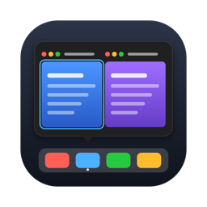
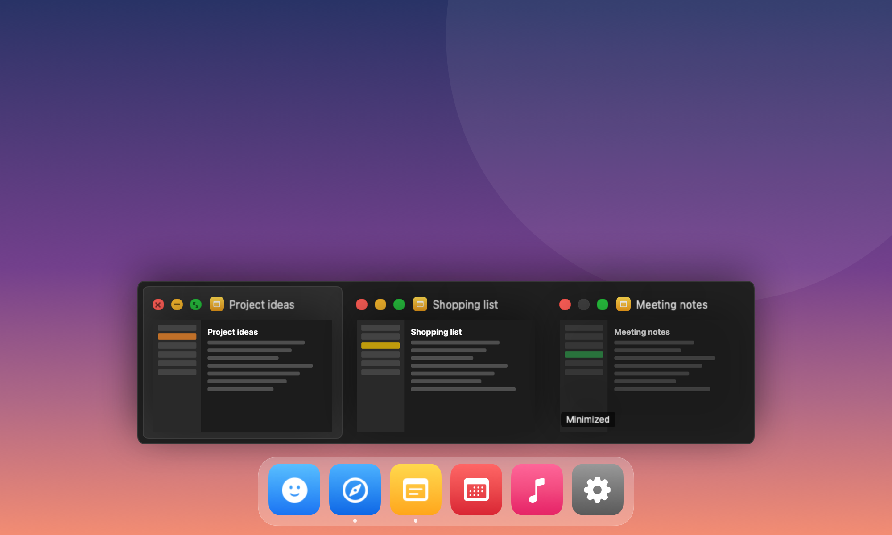
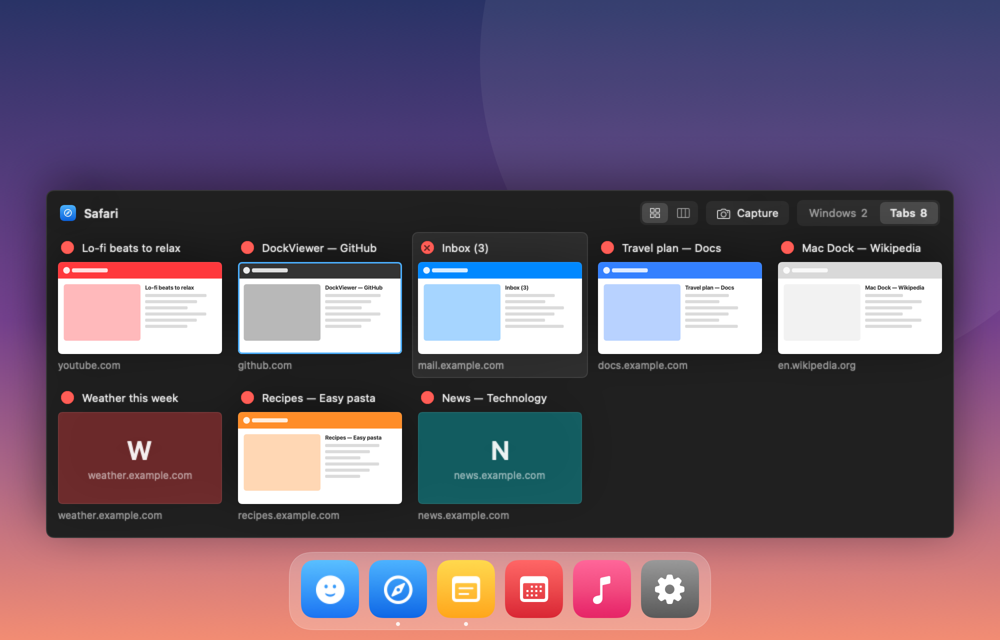
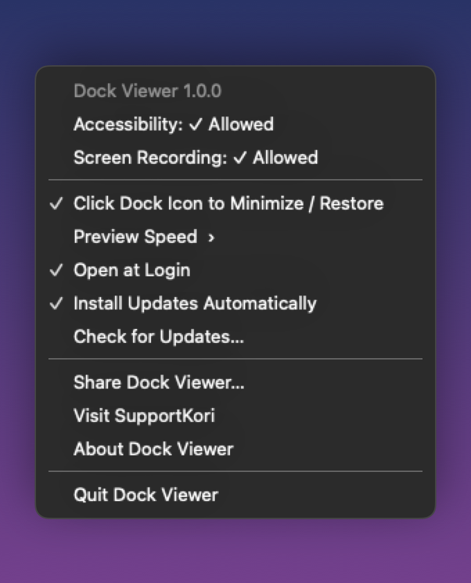

<p align="center">
  
</p>

<h1 align="center">Dock Viewer</h1>

<p align="center">
  <b>Windows-style window and browser-tab previews for the macOS Dock.</b><br>
  Hover any Dock icon to see all of its windows — even minimized ones — and jump straight to the one you want.
</p>

<p align="center">
  <a href="https://github.com/shakilnextive-beep/DockViewer/releases/latest/download/DockViewer.zip"><b>⬇ Download for Mac (free)</b></a>
  &nbsp;·&nbsp;
  <a href="https://www.supportkori.com/mdshakil463/extras/dock-viewer-free-window-tab-previews-for-mac-rjrh">SupportKori</a>
  &nbsp;·&nbsp;
  <a href="#installation">Install guide</a>
  &nbsp;·&nbsp;
  <a href="#features">Features</a>
</p>

<p align="center">
  
  
  
  
</p>

<p align="center">
  
</p>

---

## Features

### 🪟 Window previews on hover
Rest the mouse on a Dock icon and a preview card opens above it with a live thumbnail of **every window** of that app. Click a thumbnail to bring that exact window to the front.

### 🔴🟡🟢 Mac controls on every preview
Each preview has the familiar traffic-light buttons:
- **Red** closes the window
- **Yellow** minimizes it
- **Green** brings it forward and zooms it

### ➖ Minimized windows included
Minimized windows show up too, dimmed and marked *Minimized*. One click restores them.

### 🌐 Browser tab previews
For **Chrome, Opera, Safari, Edge, Brave, Vivaldi and Arc**, switch the preview from **Windows** to **Tabs** and see every open tab:
- Click a tab to jump right to it
- Close tabs from the preview
- The tab you're on has a blue outline
- Show tabs as a **grid**, or in **one row like the Dock**
- **📷 Capture** takes a picture of every tab in one go

<p align="center">
  
</p>

### 🖱 Click the Dock icon to minimize, like Windows
Click the icon of the app you're using and all its windows minimize. Click again and they come back — just like the Windows taskbar. (You can turn this off.)

### ⚙️ Small, quiet and automatic
- Lives in the menu bar, no Dock icon of its own
- Opens at login
- **Updates itself** whenever a new version is published
- Choose how fast previews appear: Fast, Normal or Relaxed

<p align="center">
  
</p>

---

## Installation

> Dock Viewer is free and not sold through the App Store, so macOS asks you to confirm it once. This takes about a minute.

### 1. Download
Download **[DockViewer.zip](https://github.com/shakilnextive-beep/DockViewer/releases/latest/download/DockViewer.zip)** (or get it from **[SupportKori](https://www.supportkori.com/mdshakil463/extras/dock-viewer-free-window-tab-previews-for-mac-rjrh)**) and double-click it. You'll get **Dock Viewer.app**.

### 2. Move it to Applications
Drag **Dock Viewer** into your **Applications** folder.

### 3. Open it the first time
Double-click **Dock Viewer**. macOS will say it *can't verify the developer*. Click **Done** (or **OK**), then:

1. Open **System Settings → Privacy & Security**
2. Scroll down. Next to *"Dock Viewer" was blocked…* click **Open Anyway**
3. Enter your password and click **Open**

You only do this once.

### 4. Allow two permissions
Dock Viewer needs two permissions to see your windows. It asks for them on first launch.

| Permission | Where | Why |
|---|---|---|
| **Accessibility** *(called "Device Control and Data Access" on newer macOS)* | System Settings → Privacy & Security | to know which Dock icon you're pointing at and to open, minimize and close windows |
| **Screen Recording** *("Screen & System Audio Recording")* | System Settings → Privacy & Security | to draw the window thumbnails |

In each list, switch **Dock Viewer** on. If it isn't in the list, click **+**, choose **Applications → Dock Viewer**, and switch it on.

Then click the Dock Viewer icon in the menu bar → **Quit**, and open Dock Viewer again.

### 5. Browser tabs (optional)
The first time you open the **Tabs** view of a browser, macOS asks *"Dock Viewer wants to control Opera"* (or Chrome, Safari…). Click **Allow**.

**That's it — hover any Dock icon.** The menu bar icon shows ✓ when everything is allowed.

---

## Using Dock Viewer

| Do this | To |
|---|---|
| Rest the mouse on a Dock icon | See the app's windows |
| Click a thumbnail | Open that window |
| 🔴 / 🟡 / 🟢 on a thumbnail | Close / minimize / zoom it |
| Click the Dock icon of the app in front | Minimize all its windows (click again to restore) |
| **Windows \| Tabs** switch (browsers) | Show windows or tabs |
| ▦ / ▭▭▭ | Tabs as a grid / one row |
| 📷 Capture | Take a picture of every tab |

### Menu bar options

- **Click Dock Icon to Minimize / Restore** — on/off
- **Preview Speed** — Fast (0.2 s), Normal (0.4 s), Relaxed (0.7 s)
- **Open at Login**
- **Install Updates Automatically** / **Check for Updates…**
- **Share Dock Viewer…**
- **About Dock Viewer**

---

## FAQ

**Is it really free?**
Yes, completely. Dock Viewer is free to use and to share with anyone. It may not be sold.

**Why does macOS warn me when I first open it?**
Apps outside the App Store that aren't registered with Apple's paid developer program get this warning. The full source code is right here for anyone to check.

**Does it send my data anywhere?**
No. Thumbnails stay in memory on your Mac. The only network request is the update check to GitHub.

**A permission shows ✗ even though its switch is on.**
Select Dock Viewer in that permission list, click **−** to remove it, then add it again with **+**.

**Some tabs show a letter instead of a picture.**
Browsers only draw the tab that's in front. Tabs get a picture once you've looked at them, or click **📷 Capture** to picture all of them at once.

**Firefox tabs?**
Firefox doesn't let other apps read its tabs. Its windows are still previewed.

**How do I uninstall it?**
Menu bar icon → **Quit**, then move **Dock Viewer** from Applications to the Trash. Optionally remove it from the permission lists in Privacy & Security.

---

## Build from source

Requires macOS 14+ and the Xcode Command Line Tools (`xcode-select --install`).

```bash
git clone https://github.com/shakilnextive-beep/DockViewer.git
cd DockViewer
./build.sh                 # builds a universal app and installs it to /Applications
```

Publishing a new version (maintainers):

```bash
scripts/release.sh 1.0.1 "What's new"
```

This builds, tags and creates a GitHub release with `DockViewer.zip`. Every installed copy updates itself, and the download link above always serves the latest version.

<details>
<summary>Project layout</summary>

| File | What it does |
|---|---|
| `Sources/DockViewer/main.swift` | App start, menu bar, hover timing |
| `Sources/DockViewer/DockWatcher.swift` | Detects which Dock icon is under the mouse |
| `Sources/DockViewer/DockClickHandler.swift` | Click-to-minimize / restore on Dock icons |
| `Sources/DockViewer/WindowManager.swift` | Lists windows, captures thumbnails, focus / minimize / close / zoom |
| `Sources/DockViewer/BrowserTabs.swift` | Reads, switches, closes and pictures browser tabs |
| `Sources/DockViewer/PreviewPanel.swift` | The preview popup's design and placement |
| `Sources/DockViewer/Updater.swift` | Automatic updates from GitHub Releases |
| `Sources/DockViewer/AppInfo.swift` | Name, version, links |
| `scripts/make-icon.swift` | Draws the app icon |
| `scripts/release.sh` | Builds and publishes a release |

Log file for troubleshooting: `~/Library/Logs/DockViewer.log`
</details>

---

## Credits

Made by **[Creative Assistant](https://www.facebook.com/profile.php?id=61596330257511)**.
Get Dock Viewer and more free tools on **[SupportKori](https://www.supportkori.com/mdshakil463/extras/dock-viewer-free-window-tab-previews-for-mac-rjrh)**.

## License

Free to use, share and modify — **not for sale**. Keep the credit to Creative Assistant. See [LICENSE](LICENSE).
